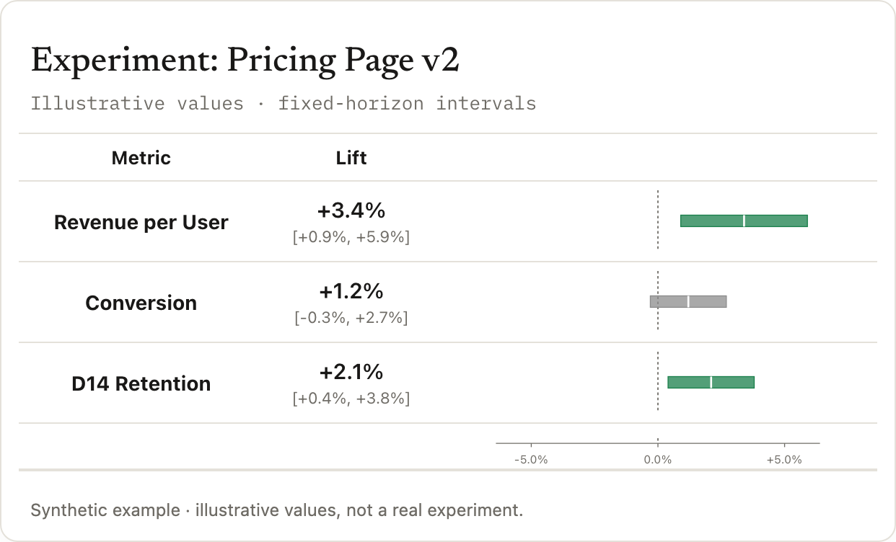

# increment

[](https://github.com/kylejcaron/increment/actions/workflows/ci.yml)
[](https://pypi.org/project/increment/)
[](https://pypi.org/project/increment/)
[](https://github.com/kylejcaron/increment/blob/main/LICENSE)

**A/B testing that shows its work.**

Increment is an open-source Python library for analyzing A/B tests. Give it a
dataframe or a SQL warehouse; it returns each metric's effect with a confidence
interval, and says plainly when the data cannot support a conclusion.

<p align="center">
  
</p>

> [!WARNING]
> Increment is in pre-release. Its API may change between releases; see the
> [compatibility policy](https://getincrement.io/docs/api/#compatibility-policy).
> Read the [statistical limitations](https://getincrement.io/docs/limitations/)
> before relying on a result.

[Documentation](https://github.com/kylejcaron/increment/tree/main/docs) ·
[Quickstart](https://github.com/kylejcaron/increment/blob/main/docs/guides/quickstart.md) ·
[Examples](https://github.com/kylejcaron/increment/blob/main/examples/README.md) ·
[Website](https://getincrement.io/)

## Install

Install the latest prerelease from PyPI:

```bash
python -m pip install --pre increment polars
```

For the API used in these examples, see the repository guides:

[Quickstart](https://github.com/kylejcaron/increment/blob/main/docs/guides/quickstart.md) ·
[data model](https://github.com/kylejcaron/increment/blob/main/docs/guides/data-model.md) ·
[metric types](https://github.com/kylejcaron/increment/blob/main/docs/guides/metric-types.md)

Increment needs Python 3.12 or newer. It reads pandas, Polars and PyArrow
dataframes; this example uses Polars.

## Quickstart

Start with one row per user: the variant they saw and what they did.

```python
from random import Random

import polars as pl

import increment

# Simulated data: treatment raises revenue and conversion by 8%.
rng = Random(7)
n = 2_000
variant = ["treatment" if rng.random() < 0.5 else "control" for _ in range(n)]
lift = [1.08 if v == "treatment" else 1.0 for v in variant]
df = pl.DataFrame(
    {
        "user_id": range(n),
        "variant": variant,
        "revenue": [rng.expovariate(1 / 10) * x for x in lift],
        "converted": [rng.random() < 0.10 * x for x in lift],
    }
)

experiment, reader = increment.from_frame(
    df,
    shape="summary",
    unit="user_id",
    group="variant",
    control="control",
    metrics=["revenue", "converted"],
)
result = increment.run(experiment, reader)
print(result.readout())
```

For an HTML table in a notebook, add the `tables` extra:

```bash
python -m pip install --pre "increment[tables]"
```

```python
import increment.tables

increment.tables.readout_table(result, title="Revenue and conversion")
```


Revenue rose 10.7%, with a 95% confidence interval of 1.5% to 20.7%. The
conversion result is inconclusive: its interval, −39.9% to +29.3%, includes
zero. Two thousand users are too few to detect an 8% change in a 10%
conversion rate; [power analysis](https://getincrement.io/docs/guides/power-analysis/)
tells you how many you need.

- `increment.from_frame` describes the experiment: the column that identifies users
  (`unit`), the column that holds the variant (`group`), the control variant,
  and the metrics. `shape="summary"` means one row per user; use
  `shape="panel"` for one row per user per day; include every assigned unit at
  least once with its assignment and exposure date ([sparse-panel preparation](https://getincrement.io/docs/guides/data-model/#one-row-per-unit-per-day)).
- Each metric's type comes from its column: floating-point numbers use `mean`,
  and Boolean columns use `conversion`. A floating-point 0/1 outcome still uses
  `mean`; if a cast can change a Boolean to float, declare the intended type
  explicitly before inspecting results, for example
  `metrics={"converted": "conversion"}`. Integer columns also need an explicit
  type because they may represent either a count or a binary outcome.
- `increment.from_frame` also returns a reader, which reads your data when
  `increment.run` needs it. `increment.run(experiment, reader)` analyzes the
  experiment. `result.readout()` lists the estimates; `result.to_frame()`
  returns them as a dataframe.
- The closing lines name checks that did not run. Here, Increment could not
  test for a sample ratio mismatch (SRM: a traffic split different from the
  plan) because the example did not state the planned split.

Next: [declare the split, a primary metric and guardrails](https://getincrement.io/docs/guides/quickstart/) ·
[reduce variance with CUPED](https://getincrement.io/docs/guides/cuped/#on-the-dataframe-path) ·
[monitor while the test runs](https://getincrement.io/docs/guides/sequential-inference/) ·
[read every result field](https://getincrement.io/docs/guides/reading-results/)

## Analyze data in your warehouse

Describe your tables, metrics and experiments once in YAML, then run the
analysis inside your warehouse through [Ibis](https://ibis-project.org/).
Install the `warehouse` extra, plus the Ibis backend you use:

```bash
python -m pip install --pre "increment[warehouse]" "ibis-framework[snowflake]"
```

<!-- skip: next "requires a configured warehouse and project definitions" -->

```python
import ibis
import increment

con = ibis.snowflake.connect(...)
experiment, reader = increment.from_definitions(
    "definitions/", con, experiment_name="checkout_redesign"
)
with reader:
    result = increment.run(experiment, reader)
print(result.readout())
```

Any Ibis SQL backend is supported. DuckDB, PostgreSQL, Snowflake, and BigQuery
are verified by execution test suites; other backends show a one-time
`UnverifiedWarehouseWarning`. An analysis runs when Ibis can translate its
queries for that backend, and stops with `query.backend.operation_unsupported`
when it cannot. The default captured run needs TEMP tables. Scalar warehouse
CUPED can use `coherence="live"`; multicovariate CUPED fitting and
categorical-cell acquisition need TEMP tables. Unit-day artifacts need a
verified backend. The
[data-model guide](https://getincrement.io/docs/guides/data-model/) explains
the YAML and [other warehouses](https://getincrement.io/docs/guides/data-model/#other-warehouses),
and the
[warehouse example](https://github.com/kylejcaron/increment/blob/main/examples/analysis_from_a_warehouse.py)
is a notebook that runs the whole workflow on a local DuckDB database.

## What else it does

- **Plan**: sample size, power and minimum detectable effect.
- **Reduce variance**: CUPED with pre-experiment data.
- **Monitor**: sequential tests that stay valid when you look at results repeatedly.
- **Correct for many comparisons** across metrics and segments.
- **Use priors**: Bayesian estimates and the probability that a variant is better.
- **Break results down** by segment or by day.
- **Analyze other designs**: switchback, encouragement and observational
  (IPTW, AIPW, DML) studies.
- **Report**: readout tables, and an HTML dashboard for warehouse experiments.

The [method guide](https://getincrement.io/docs/guides/choose-a-method/) helps
you choose; the [compatibility matrix](https://getincrement.io/docs/guides/compatibility/)
lists which methods combine.

## Optional extras

Install extras with `python -m pip install --pre "increment[<extra>]"`:

| Package | Adds |
|---|---|
| `increment[warehouse]` | Ibis and SQLGlot for SQL warehouses; add your warehouse's Ibis backend |
| `increment[demo]` | Warehouse support and DuckDB, for local examples |
| `increment[tables]` | Formatted readout tables (CoefTable and pandas) |
| `increment[dashboard]` | An HTML experiment dashboard (marimo, anywidget, CoefTable and pandas) |

## Before you rely on a result

When a request is not supported, Increment stops with an error code that names
a fix. When one estimate cannot be computed, it is reported as unavailable,
with the reason, instead of being dropped. Methods carry assumptions: read the
[statistical limitations](https://getincrement.io/docs/limitations/) and the
[validation evidence](https://getincrement.io/docs/validation/).

Increment analyzes data you already have. It does not assign traffic, run
feature flags, or store events.

## Contributing and license

See [CONTRIBUTING.md](https://github.com/kylejcaron/increment/blob/main/CONTRIBUTING.md).
Contributions require a signed
[Contributor License Agreement](https://github.com/kylejcaron/increment/blob/main/.github/CLA.md).

Apache License 2.0. See [LICENSE](https://github.com/kylejcaron/increment/blob/main/LICENSE)
and [NOTICE](https://github.com/kylejcaron/increment/blob/main/NOTICE).
Copyright 2026 Kyle Caron.
